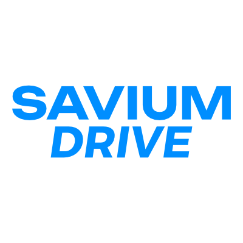
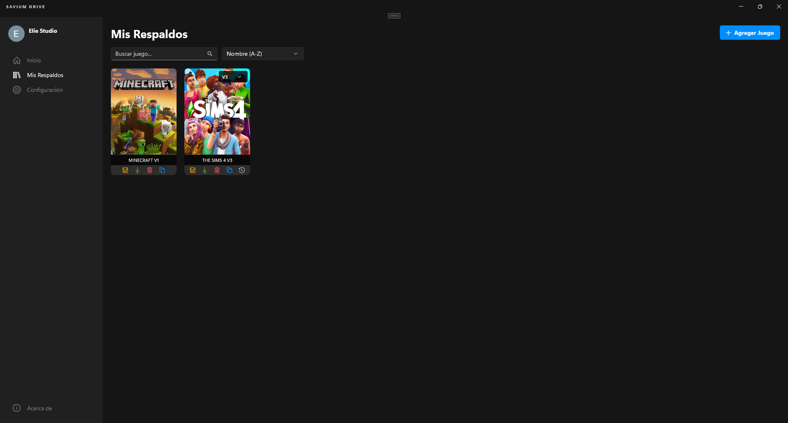
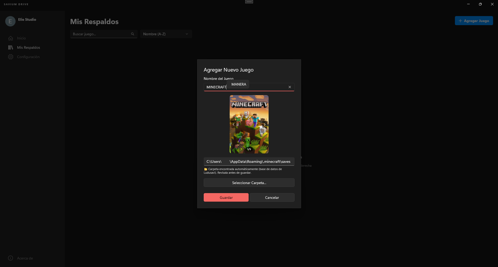
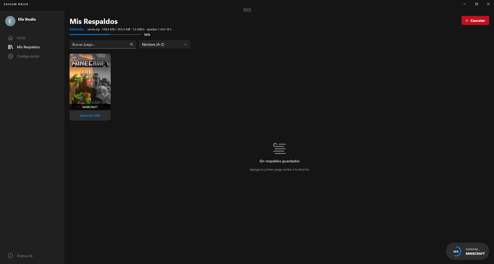
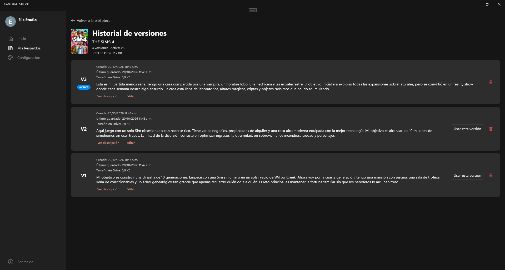
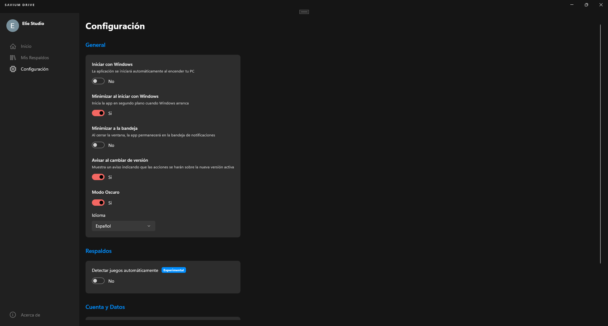

<p align="center">
  
</p>

<p align="center">
  <b>Copias de seguridad de tus partidas en Google Drive.</b>
</p>

<p align="center">
  <a href="https://github.com/eliestudioteam/SaviumDrive/actions/workflows/ci.yml"></a>
  
  
  <a href="LICENSE"></a>
</p>

---

**Savium Drive** es una aplicación para Windows que guarda las partidas de tus juegos en tu propia cuenta de Google Drive. Así no pierdes tu progreso al formatear, cambiar de equipo o jugar a un juego sin guardado en la nube.

## Funciones

### Biblioteca

<p align="center"></p>

Todos tus juegos en un solo lugar, con su portada. Desde cada juego puedes:

- **Guardar** una copia de seguridad.
- **Restaurar** la partida en este equipo.
- **Crear una nueva versión** o **ver su historial**.
- **Eliminar** el juego (se envía a la papelera de Drive).

La biblioteca se puede buscar por nombre y ordenar alfabéticamente o por la fecha del último guardado.

### Agregar un juego

<p align="center"></p>

Basta con escribir el nombre del juego: Savium Drive busca su portada y la carpeta donde guarda las partidas. También puedes elegir la carpeta manualmente.

### Copias de seguridad

<p align="center"></p>

- Progreso en tiempo real, con velocidad y tiempo restante.
- Al actualizar una copia solo se suben los archivos que cambiaron.
- Las operaciones se pueden cancelar en cualquier momento.

### Versiones

<p align="center"></p>

Cada juego puede tener varias partidas independientes (V1, V2, V3...), cada una con su descripción. Elige qué versión está activa y el historial muestra la fecha y el tamaño de cada una.

### Restaurar partidas

Restaura cualquier versión en tu equipo. Si las partidas de tu equipo son más recientes que la copia, Savium Drive te avisa antes de reemplazarlas, y tus archivos no se tocan hasta que la descarga termina correctamente.

### Recordatorio al cerrar un juego (experimental)

Al cerrar un juego, Savium Drive te pregunta si quieres guardar tu partida. Si el juego todavía no está en tu biblioteca, te ofrece agregarlo con los datos ya completados. Funciona con juegos de Steam, Epic Games y GOG, y con la mayoría de juegos de otras plataformas.

### Varios equipos

Tu biblioteca se sincroniza con Google Drive: inicia sesión en otro equipo y tendrás tus juegos disponibles. Cada equipo recuerda su propia carpeta de partidas.

### Configuración

<p align="center"></p>

Inicio con Windows, minimizar a la bandeja del sistema, tema claro u oscuro, idioma (español e inglés) y el recordatorio de juegos.

## Descarga

Descarga el instalador desde la [última versión](https://github.com/eliestudioteam/SaviumDrive/releases/latest)
o desde la [página web](https://eliestudioteam.github.io/SaviumDrive/). Funciona en Windows 10 (1809) y Windows 11.

Windows puede mostrar un aviso de SmartScreen porque la app aún es nueva: pulsa **Más información → Ejecutar de todas formas**.

¿Encontraste un fallo o tienes una idea? Abre un [issue](https://github.com/eliestudioteam/SaviumDrive/issues).

## Compilar desde el código

**Requisitos**

- Windows 10 (versión 1809) o superior.
- [Visual Studio 2022 o posterior](https://visualstudio.microsoft.com/) con la carga de trabajo **Desarrollo de aplicaciones WinUI**.
- [.NET 8 SDK](https://dotnet.microsoft.com/download/dotnet/8.0).

**Claves de API**

Las claves de SteamGridDB y del cliente OAuth de Google no están en el repositorio. Copia
`SaviumDrive/Secrets.props.example` como `SaviumDrive/Secrets.props` y rellénalo con las tuyas
(git ignora ese archivo). Sin claves la app compila igual, pero no busca portadas ni puede iniciar sesión en Google.

**Compilar**

```bash
git clone https://github.com/eliestudioteam/SaviumDrive.git
cd SaviumDrive
dotnet build SaviumDrive/SaviumDrive.csproj -c Release -p:Platform=x64
```

También puedes abrir `SaviumDrive.sln` en Visual Studio y ejecutarlo.

**Pruebas**

```bash
dotnet test tests/SaviumDrive.Tests
```

## Privacidad

Tus partidas se guardan únicamente en tu cuenta de Google Drive, en la carpeta `SaviumBackups`. Savium Drive solo tiene acceso a los archivos que crea, no al resto de tu Drive, y no utiliza servidores propios. Detalles en la [política de privacidad](PRIVACY.md) ([English](PRIVACY.md#privacy-policy-for-savium-drive)).

## Créditos

- Portadas de [SteamGridDB](https://www.steamgriddb.com/).
- Ubicación de las partidas de [Ludusavi Manifest](https://github.com/mtkennerly/ludusavi-manifest).

## Licencia

Distribuido bajo la licencia MIT. Consulta [LICENSE](LICENSE).

<p align="center">Desarrollado por <b>Eliestudio</b></p>
